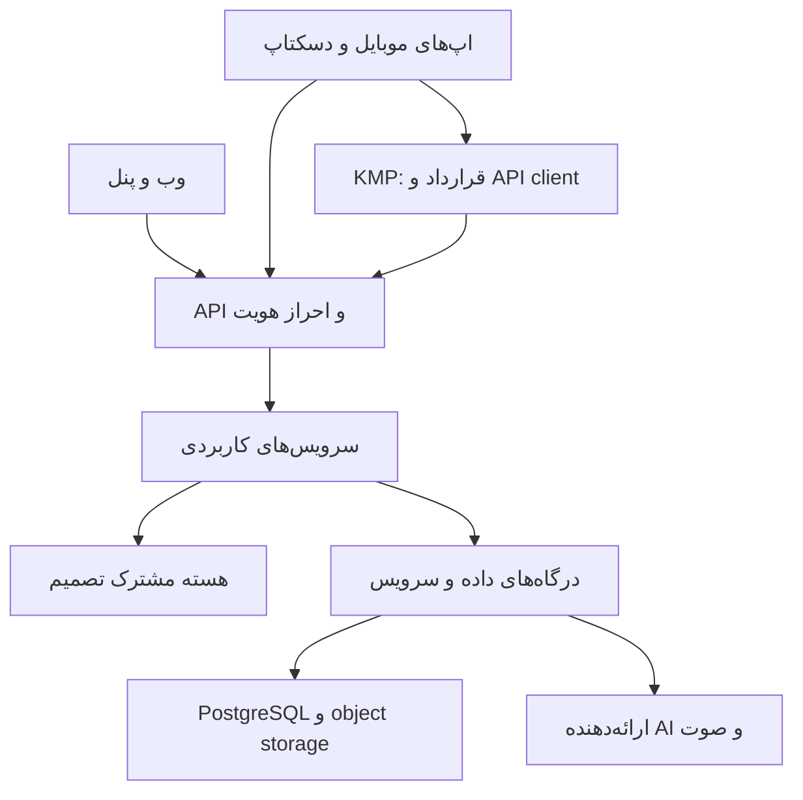

# ADR-010 — معماری وب و اپ‌های White Hat / Second Mind

نسخه 1.0.0 · تاریخ 2026-11-11 · وضعیت: تصمیم اجرایی این مرحله بر اساس دستور مالک؛ پذیرش محصول و انتشار جداست.

## تصمیم

Kotlin زبان اصلی سرور و کد مشترک اپ‌ها است. backend با Kotlin/JVM و Ktor؛ کلاینت‌های Android و iOS با Kotlin Multiplatform و Compose Multiplatform؛ دسکتاپ macOS/Windows با Compose Desktop. وب و پنل، رابط DOM موجود را حفظ می‌کنند و در توسعه بعدی تدریجاً TypeScript می‌گیرند. Kotlin/Wasm و Compose Web فعلاً وابستگی ضروری وب تجاری نمی‌شوند.

هدف، یک سرویس و یک مدل دامنه قابل‌استفاده توسط چند رابط است. اشتراک کد به معنی تحمیل یک UI یکسان به همه دستگاه‌ها نیست. رفتار AI، مجوز، سهمیه، پرداخت و ثبت نتیجه فقط در سرور authority دارند. کد client-shared فقط شامل قرارداد، اعتبارسنجی ورودی، API client و state نمایش است؛ prompt، کلید و قواعد محرمانه تصمیم در اپ بسته‌بندی نمی‌شوند.

## مبنای واقعی و تقدم منابع

- مخزن `hypermindedd/white-hat` در main و شاخه build بررسی شد؛ pin: `6829dc1d1c003dd0a138aff1465f6a8fbd4091c0`. هر دو فقط بسته اسناد بودند.
- بسته `SECOND-MIND-STANDALONE-0.3.0-BACKUP-2026-11-03.zip` بازیابی شد؛ SHA256: `a16bf3407133890e7537106f848d04de4c8e7a0346dd5059a0a53b08d9fdd719`.
- ۲۱ فایل اجرایی با hashهای manifest خود بسته تطبیق دارند. سورس بازیابی‌شده در `apps/second-mind/` حفظ شده است: HTML/CSS/JavaScript، Node HTTP، SQLite، provider adapter و ۲۳ آزمون.
- این بسته دارای پنل مدیر/عضو، تاریخچه و کیفیت است. آخرین طراحی جامع پشتیبانی و analytics مطرح‌شده در گفتگوهای دیگر در این snapshot احراز نشده؛ آن طراحی با پنل عمومی Elyora یکی فرض نمی‌شود. این بسته «آخرین طراحی امروز» نامیده نمی‌شود.
- درخواست فعلی مالک، ساخت مستقل وب‌اپ و اپ‌ها با معماری Kotlin را مجاز می‌کند. اسناد تاریخی GPTs-first مسیر اجباری ساخت جدید نیستند؛ ontology، هفت Mode و قراردادهای معنایی همچنان مرجع‌اند.
- طراحی مذاکره زنده در شاخه `design/live-negotiation-20261111` جداست. این ADR مرزهای آن را لحاظ می‌کند؛ هیچ اتصال زنده یا merge آن شاخه را اعلام نمی‌کند.

## انتخاب زبان و پلتفرم

| بخش | انتخاب | علت و مرز |
|---|---|---|
| هسته تصمیم و orchestration | Kotlin/JVM، ماژول مستقل از Ktor | قابلیت تست و حفظ هفت Mode روی یک هسته؛ یک مدل با مراحل متعدد |
| API و gateway | Ktor روی JDK 21 | اتصال HTTP، streaming و WebSocket پشت ماژول‌های دامنه؛ adapter قابل تعویض |
| Android | Kotlin Multiplatform + Compose | API client و قرارداد مشترک؛ دسترسی دستگاه از adapter Android |
| iPhone / iPad | Kotlin Multiplatform + Compose، host و اتصال‌های لازم Swift | اشتراک منطق/بخش عمده UI؛ build و امضا و آزمون در Xcode روی macOS |
| macOS / Windows | Compose Desktop روی JVM | اپ نصب‌شدنی با runtime همراه؛ adapter جدا برای audio، keychain و updates |
| وب و پنل | HTML/CSS/JS موجود؛ TypeScript در مرحله توسعه ماژول‌ها | حفظ طرح موجود، DOM، RTL و قابلیت دسترسی؛ framework تازه بدون نیاز واقعی تحمیل نشود |
| مرجع قرارداد API | OpenAPI و JSON Schema نسخه‌دار | قرارداد مرجع برای TypeScript و Kotlin؛ generated clients و سازگاری با نسخه قدیمی |
| پایگاه داده سرور | PostgreSQL با migration نسخه‌دار | تراکنش، چندکاربره و جداسازی workspace؛ SQLite قدیمی فقط runtime alpha است |
| فایل و صوت | object storage سازگار S3، URL کوتاه‌عمر | دسترسی با مجوز، retention و حذف قابل‌کنترل؛ فایل در DB اصلی نگه‌داری نشود |
| صف اولیه | جدول jobs + outbox در PostgreSQL | ثبت تراکنشی و بازیابی job؛ Redis یا broker پس از نیاز اندازه‌گیری‌شده |
| محیط تولید | کانتینر JVM روی Linux، reverse proxy و TLS | اجرای Kotlin server مستقل از میزبان وب؛ انتخاب فروشنده و ظرفیت بعد از pilot |

Compose برای Android/iOS/Desktop در جدول رسمی Stable و برای Web/Wasm در Beta گزارش شده است. KMP و Compose دو فناوری متفاوت‌اند؛ پایداری KMP روی JS، اثبات پایداری Compose Web نیست. این واقعیت و حفظ سرمایه UI مبنای انتخاب وب DOM است. این تصمیم تضمین عملکرد، accessibility یا بی‌نقصی هیچ framework نیست.

گزینه‌های بررسی‌شده: Kotlin همه‌جا با Compose Web، Flutter، React Native، وب داخل wrapper و Kotlin+وب مستقل. Kotlin+وب مستقل انتخاب شد چون Kotlin موردنظر مالک را با استفاده از UI موجود و مسیر اپ‌های واقعی جمع می‌کند. wrapper موقت PWA می‌تواند دسترسی نصب وب بدهد؛ خروجی بومی امضاشده محسوب نمی‌شود. Spring Boot گزینه معتبر JVM است؛ برای این دامنه و سرویس اولیه، Ktor را با مالکیت صریح زیرساخت انتخاب می‌کنیم. مقایسه کارایی بدون benchmark ادعا نشده است.

## ساختار منطقی

نمودار مرز هدف است؛ همه اجزا هنوز پیاده نشده‌اند. Gradle چندماژولی و یک modular monolith انتخاب می‌شود. هسته به transport یا DB وابسته نیست. سرویس‌های اولیه را در یک deployment نگه می‌داریم؛ worker می‌تواند از همان کد، process جدا داشته باشد. استخراج microservice فقط با نیاز مستقل مقیاس/امنیت/تیم و شواهد عملیاتی انجام می‌شود.

مسیرهای هدف: `shared/contracts`، `shared/client`، `server/domain`، `server/application`، `server/adapters`، `server/api`، `apps/mobile`، `apps/desktop`، `contracts/openapi` و `infra`. فقط `shared/contracts` در این مرحله ساخته می‌شود؛ باقی مسیرها برنامه‌اند. `apps/second-mind` سورس alpha بازیابی‌شده است و تا cutover تنها runtime موجود باقی می‌ماند.

## مرز ماژول‌ها و نویسندگان داده

| ماژول | ورودی / خروجی | مالک نوشتن و قواعد |
|---|---|---|
| identity / access | subject احراز‌شده → عضویت و permission | سرویس access؛ deny by default؛ scope سازمان/کاربر/منبع؛ UI مجوز تولید نمی‌کند |
| decision | ورودی نرمال و شواهد → Decision Object | سرویس تصمیم؛ هر تصمیم revision و مالک دارد |
| challenge / runs | Decision revision + Mode → run و نتیجه معتبر | coordinator تنها نویسنده run؛ یک active run برای همان revision |
| evidence | فایل/ادعا/منبع → provenance و extraction | evidence service؛ گفته کاربر یا شبیه‌سازی «تأیید بیرونی» نمی‌شود |
| provider | درخواست نسخه‌دار → پاسخ/usage/receipt | adapter فاقد authority تغییر حکم؛ validator سرور قبل از commit |
| usage / entitlement | reservation → مصرف واقعی و release | ledger append-only؛ مبلغ/سهمیه از مرورگر پذیرفته نمی‌شود |
| billing | webhook تأییدشده → حق استفاده | سرویس billing با event ID یکتا؛ نمایش موفقیت مرورگر مبنای entitlement نیست |
| live negotiation | turn نهایی + revision → پاسخ همان هسته | turn coordinator؛ transport state پایدار را مستقیم نمی‌نویسد |
| support / admin | درخواست نقش‌دار → اقدام محدود و audit | application service مربوط؛ پشتیبان پیش‌فرض متن تصمیم/فایل خصوصی را نمی‌بیند |
| analytics | رخداد حداقلی → aggregate قابل‌توضیح | projection writer؛ مجهول با صفر و درآمد با مصرف توکن یکی نیست |

نقش‌ها permissionهای قابل‌تعریف دارند. قالب‌های اولیه: مالک workspace، مدیر، پشتیبانی، ارزیاب کیفیت، مالی، عضو و مشاهده‌گر؛ نام نقش به‌تنهایی مجوز نیست. آخرین مالک workspace قابل حذف بدون انتقال معتبر نیست. دسترسی به متن خصوصی برای بررسی نیاز به permission محدود، دلیل و audit دارد. تغییر نقش، revoke نشست و تست منع دسترسی جزو پذیرش‌اند.

جمع‌آوری سن/جنسیت/موقعیت/علایق و استفاده از محتوای تصمیم برای آموزش AI خودکار فعال نمی‌شود. analytics عملیاتی، پیشنهاد محصول و training dataset سه پردازش مجزا با رضایت، retention، حذف و کنترل دسترسی مستقل هستند. قراردادهای تجاری و رضایت قبل از فعال‌شدن آن‌ها مشخص می‌شوند.

## قرارداد، tenancy و هویت

- API هدف `/api/v1` است. alpha فعلی `/api/*` است؛ facade باید پاسخ و خطاهای قبلی را تا مهاجرت حفظ کند. قرارداد و test fixtures پیش از تعویض backend ثبت شوند.
- `SM-KNOW-06` envelope نسخه 1.0 مرجع معنایی است. alpha خروجی flat دیگری دارد؛ `LegacyOutputValidator` صریحاً validator آن قرارداد قدیمی است. این دو schema معادل فرض نمی‌شوند و mapper حدسی به‌جای Decision Object واقعی ساخته نمی‌شود.
- قرارداد OpenAPI هنوز تولید نشده و route Kotlin این مرحله وجود ندارد. تغییر wire ID، vocabulary یا version بدون fixture و migration مجاز نیست.
- tenant/workspace از عضویت احراز‌شده سرور استخراج و با درخواست انتخاب workspace تطبیق داده می‌شود. queryها scope کامل دارند؛ RLS به‌عنوان دفاع اضافی، با role غیر bypass و tenant transaction-local آزموده شود. tenant ID در body به‌تنهایی مجوز نیست.
- هدف هویت: OIDC با Authorization Code + PKCE برای اپ‌ها، نشست HttpOnly/Secure و CSRF برای وب از مسیر BFF/gateway. access token کوتاه‌عمر، refresh rotation و revoke؛ ذخیره در Keychain/Keystore، نه localStorage. سرویس ارائه‌دهنده هویت هنوز انتخاب/متصل نشده است.
- نصب عمومی `setup` alpha یا رمزهای محلی SQLite عیناً وارد محصول چندمستاجری نمی‌شوند. انتقال حساب یا federation نیازمند مسیر مهاجرت و آزمون است.
- schema DB: ابتدا explicit tenant/workspace/member؛ سپس decisions، runs، evidence، usage و audit؛ کلیدهای رابطه‌ای tenant-aware. هیچ داده قدیمی بدون نگاشت معتبر workspace منتقل نمی‌شود.

## چرخه اجرا، تکرار و خرابی

یک run حالت‌های queued، running، succeeded، failed، cancelled و reconciliation_required دارد. کلید idempotency در scope کاربر/tenant یکتا و به hash ورودی و revision بسته است. درخواست تکراری همان نتیجه؛ کلید یکسان با payload متفاوت 409؛ stale revision نیز conflict است. این قواعد هدف Kotlin‌اند؛ alpha واژگان وضعیت فعلی خود را تا facade نگه می‌دارد.

رزرو سهمیه و ثبت run و outbox در یک تراکنش؛ worker با lease و fencing token claim می‌کند. هنگام فراخوانی AI تراکنش DB باز نمی‌ماند. پاسخ فقط برای revision و lease معتبر ثبت می‌شود. cancellation پاسخ دیرهنگام را معتبر نمی‌کند؛ قطع UI اثبات لغو هزینه provider نیست. timeout یا گم‌شدن پاسخ provider هرگز خودکار به اجرای دوم نامطمئن منجر نمی‌شود؛ receipt/usage reconcile یا علامت بررسی دستی می‌گیرد. HTTP دقیقاً یک‌بار برای side effect خارجی تضمین نمی‌کند.

در شکست schema، refusal، قطع stream یا عدم تنظیم provider هیچ حکم موفق ساختگی نداریم. متن خام خطای provider، token و رونوشت خصوصی وارد log عمومی نمی‌شوند. audit دارای actor، tenant، action، target، زمان و correlation ID است؛ محتوای حساس فقط با policy لازم و دسترسی محدود.

## صوت و مذاکره زنده

رابط `VoiceTransport` برای وب WebRTC و برای اپ‌ها adapter سازگار SDK/native audio دارد. signaling، credential کوتاه‌عمر، budget و permission در سرور است. هیچ فرضی درباره وجود endpoint اختصاصی donor پذیرفته نمی‌شود. استخراج از Elyora بعد از source pin و تست provider صورت می‌گیرد؛ auth، DB و شخصیت آموزشی منتقل نمی‌شوند.

مذاکره نوع تعامل است، نه Mode هشتم. مدل صوت presenter است؛ حکم از همان Decision Challenge Engine می‌آید. transcript نهایی یا تأییدشده وارد turn می‌شود؛ delta موقت است. event ID، expectedRevision، barge-in، حذف پاسخ منسوخ، reconnect و سقف هزینه تست می‌شوند. تماس با شخص ثالث و پذیرش تعهد بیرونی در این دامنه اجرا نمی‌شوند.

## اپ و داده محلی

نسخه اول online-first است؛ آفلاین می‌تواند پوسته و draft محلی بدهد، نه تحلیل AI آفلاین. session و داده حساس با adapter امن دستگاه؛ خروج از حساب پاک‌سازی cache لازم را انجام می‌دهد. offline sync و حل تعارض پیش از فعال‌شدن تاریخچه محلی کامل تعریف می‌شوند. داشتن تاریخچه همان تصمیم به معنی حافظه تحلیلی میان همه تصمیم‌ها نیست.

اپ دسکتاپ cloud client است و backend مستقل با اسرار را روی هر دستگاه نصب نمی‌کند. local-first یا enterprise on-prem مسیر جدا با قرارداد استقرار و مجوز است؛ معماری ports آن را ممکن می‌کند، اما از حالا تحویل‌شده نیست.

## مسیر ساخت و معیار عبور

| مرحله | خروجی | معیار عبور |
|---|---|---|
| ۰ — این تحویل | بازیابی سورس، ADR، module مشترک، شواهد baseline | hash source، آزمون alpha، تست Kotlin و compile JS؛ هیچ ادعای production |
| ۱ | OpenAPI، fixtures و Kotlin/Ktor API با auth و PostgreSQL | parity routeها، tenant isolation، migration آزمایشی، provider sandbox و idempotency |
| ۲ | اتصال پنل/وب موجود و تکمیل نقش‌ها | E2E کاربر و پشتیبان، RTL/accessibility، نبود secret و خطای دسترسی |
| ۳ | هسته کامل AI و افزونه مذاکره پشت flag | goldenهای هفت Mode، ارزیابی ۱۵بعدی/۶۰ کیس، صوت روی دستگاه، usage واقعی |
| ۴ | اپ موبایل و دسکتاپ روی API تثبیت‌شده | Android، iPhone/iPad، Mac و Windows واقعی؛ قطع شبکه، audio، deep link، upgrade |
| ۵ | آمادگی تجاری و انتشار | billing، backup/restore، load test، security، امضا، notarization و store review |

اسکلت اپ و بررسی ریسک audio می‌تواند زودتر ساخته شود؛ انتشار اپ به قرارداد پایدار و تست واقعی وابسته است. تاریخ تحویل بدون ظرفیت تیم، دسترسی provider و محیط‌های هدف تعهد نمی‌شود. ظرفیت و SLO بعد از pilot و اندازه‌گیری latency، خطا و هزینه به‌ازای challenge تعیین می‌شوند.

## مهاجرت و rollback

۱) snapshot و hash UI/API/DB alpha؛ توقف تغییر ناسازگار. ۲) قرارداد و parity بدون اجرای دو provider برای درخواست پولی. ۳) تست مهاجرت روی کپی داده و نگاشت workspace؛ source DB تغییر نمی‌کند. ۴) cutover workspace با maintenance کوتاه، توقف writer قبلی، backup و checkpoint؛ فقط Kotlin writer فعال. ۵) پایش و reconciliation؛ rollback طبق مرحله داده.

پیش از پذیرش write جدید: برگشت route به alpha و snapshot کافی است. پس از write در PostgreSQL: برگشت ساده به SQLite قدیمی ممنوع، چون داده از دست می‌رود؛ ابتدا توقف writes، export سازگار و replay/inverse migration آزموده‌شده یا forward fix با binary سازگار قبلی. migrationهای expand/contract و حفظ compatibility window اجباری‌اند. schema مخرب تا پایان پنجره بازگشت حذف نمی‌شود. خاموش‌کردن voice flag باید متن را سالم نگه دارد.

## شواهد و محدودیت فعلی

تست قرارداد، کیفیت تصمیم AI را ثابت نمی‌کند. اتصال AI واقعی، پنل جامع امروز، Ktor runtime، PostgreSQL، اپ‌ها، نصب‌کننده، store و انتشار هنوز در این مرحله پذیرفته نشده‌اند. independent review نهایی و آزمون انسانی/دستگاهی باز می‌مانند. شواهد ماشینی این مرحله در `evidence/kotlin-foundation/` ثبت می‌شود.

## منابع رسمی بررسی‌شده

- https://kotlinlang.org/docs/multiplatform/supported-platforms.html
- https://kotlinlang.org/docs/multiplatform/multiplatform-share-on-platforms.html
- https://kotlinlang.org/docs/multiplatform/compose-native-distribution.html
- https://ktor.io/docs/server-application-structure.html
- https://kotlinlang.org/docs/gradle-configure-project.html

نسخه‌های آزمایش foundation: Kotlin 2.2.20، serialization 1.9.0، Gradle 8.14.3، JDK 21. این‌ها ادعای «جدیدترین نسخه» نیستند؛ baseline قابل‌تکرار این مرحله‌اند. نسخه Ktor/Compose/AGP/Xcode هنگام ساخت آن لایه با ماتریس سازگاری و تست در catalog قفل می‌شود؛ انتخاب نام پلتفرم با ادعای نسخه buildشده مخلوط نشود.
